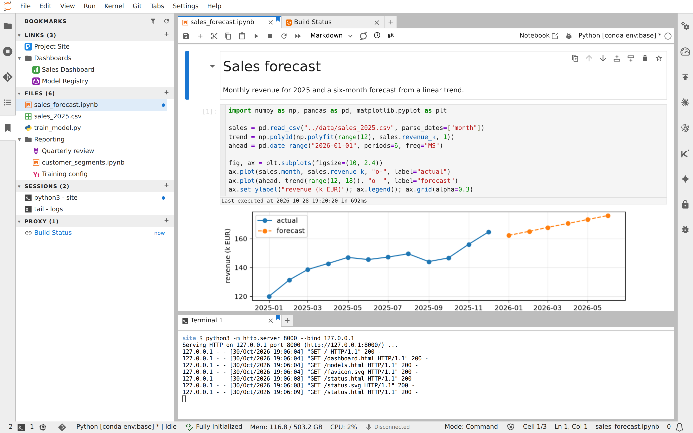

# jupyterlab_bookmarks_manager_extension

[](https://github.com/stellarshenson/jupyterlab_bookmarks_extension/actions/workflows/build.yml)
[](https://www.npmjs.com/package/jupyterlab_bookmarks_manager_extension)
[](https://pypi.org/project/jupyterlab-bookmarks-manager-extension/)
[](https://pepy.tech/project/jupyterlab-bookmarks-manager-extension)
[](https://jupyterlab.readthedocs.io/en/stable/)
[](https://kolomolo.com)
[](https://www.paypal.com/donate/?hosted_button_id=B4KPBJDLLXTSA)

Bookmarks for JupyterLab in one side panel. Web pages, files and terminal sessions each have their own section of folders and bookmarks, a fourth section lists the pages recently opened through the lab's server proxy, and a main-area tab whose page, file or terminal is bookmarked carries a ribbon. The context menu of a tab adds it to the bookmarks or removes it, a drag of the tab onto the panel adds it, and a click on a bookmark opens it again.



## Features

- **Side panel** - A Bookmarks panel in the left side bar; Switch Sidebar Side in the context menu of its side-bar tab moves it to the right
- **Refresh** - The Refresh icon button in the panel top bar checks every file bookmark for a missing file and reads the running terminals again, then redraws the sections; the icon spins while it works
- **Filter** - The Filter icon button in the panel top bar shows and hides a filter box; typed text narrows the four sections to the bookmarks whose name, URL, path or command contains it and to the recent pages whose title or URL contains it, case ignored; a folder holding a match stays open, and an empty or hidden box shows every row with the fold state unchanged
- **Four sections** - Links, Files, Sessions and Recent Proxy, each header showing how many bookmarks or recent pages the section holds; an empty Links, Files or Sessions section names Add Tab to Bookmarks as the way to fill it, and an empty Recent Proxy section reads No recent proxy pages
- **Tab menu** - Add Tab to Bookmarks in the context menu of a web page, file or terminal tab; on a tab already bookmarked the item reads Remove Tab from Bookmarks, and other tabs, such as the Launcher, show no item
- **Drag a tab** - A main-area tab dragged onto the panel is added as a bookmark of the section its kind matches; dropped on a folder row of that section it goes into the folder, and the target section or folder shows a drop mark
- **Folders** - New Folder in the + menu of a section header adds a folder at the section root; the folder's context menu renames it, or deletes it and its bookmarks after a confirmation that names how many bookmarks it holds
- **New Bookmark** - New Bookmark... in the + menu of a section header opens the section's edit dialog with empty fields; Save adds the bookmark at the section root, or in the folder chosen in the dialog, and runs the checks of an edit: a link gets its favicon, a missing file is marked, and an environment line with a secret name disables Save
- **Folding** - The tree starts expanded; while the filter box is empty, a click on a folder folds and unfolds it; the toggle in a section header folds and unfolds the section, and a folded folder stays folded after a reload
- **Edit and remove** - Edit Bookmark... in a bookmark's context menu changes its name and moves it into a folder or back to the section root; Remove Bookmark deletes it
- **Keyboard** - The rows of a section are one Tab stop; Up and Down move between rows, and Enter opens a bookmark, reopens a recent proxy page or, while the filter box is empty, folds and unfolds a folder
- **Links** - A web tab is saved with its title and the address it shows, and the name and the URL can be edited; a click opens a page on the lab's origin in a lab tab, reusing that tab while it is open, and a page on another origin in a new browser tab
- **Relative lab links** - A link to a page of the lab is stored relative to the lab's base URL, so it also opens when the lab is reached under another host name
- **Favicons** - Each link shows its page's favicon, stored in the bookmark so a reload shows it without a request; the server fetches the icon of a page on another origin, a URL change fetches the new page's icon, and a page without an icon shows the generic link icon
- **Files** - A document tab is saved with its file name and its path relative to the Jupyter server root, and its row shows its file-type icon; a click opens the file or activates its open tab, and Reset Name in the edit dialog sets the name back to the file name
- **Missing files** - A bookmark whose file does not exist is marked File not found in the panel and in the edit dialog, and a click on it opens no tab; once the file exists again, the next click on the row, a page reload or Refresh clears the mark
- **Sessions** - A terminal tab is saved as a recipe: the working directory, the foreground command with its parameters, and the environment variables that differ from the shell's own, read from /proc on a Linux server; on a system without /proc, such as Windows, the server extension loads and a captured session has an empty command and no variables; the bookmark is named after the command and the directory
- **Secret variables left out** - A variable whose name contains TOKEN, SECRET, PASSWORD, PASSWD, API_KEY or CREDENTIAL, in any case, is never recorded, and the session edit dialog disables Save for one
- **Environment filter** - A captured session also leaves out every variable whose name matches an expression of the Session environment filter setting: * matches any run of characters, ? one character and [...] one of a set, case kept; a changed list applies to the next capture without a page reload
- **Environment by hand** - A variable name typed into the environment field of the session edit dialog is kept and exported on the next start even when it matches the filter list; the dialog refuses only the names the recording always leaves out
- **Opening a session** - A click activates the tab of a terminal that runs the same command in the same directory, or opens a tab on it when its tab was closed; otherwise it starts a terminal in the stored directory that exports the variables and types the command, and a second click while it starts opens no second terminal
- **Editing a session** - The edit dialog changes the name, the command, the working directory and the environment for the next start, and leaves a running terminal and its process alone
- **Recent Proxy** - The section below Sessions lists the pages opened through the lab's server proxy, the command the launcher and notification buttons run, that no Links bookmark holds, newest first, each with its title and age; a click reopens the page the way it was first opened and moves its row to the top, the row's menu adds it to Links or removes it from the list, the list survives a page reload, and an entry not opened for longer than Recent proxy days (default 3) leaves it
- **Marks** - A main-area tab whose page, file or terminal is bookmarked carries a ribbon at its top edge, and the bookmark's panel row a dot; the row of the current tab is tinted, and Marker colour picks the colour, brand by default or red; the marks follow tabs opening, closing and switching without a page reload
- **Storage** - Bookmarks are kept in the JupyterLab setting `bookmarks` of `jupyterlab_bookmarks_manager_extension:plugin` and are the same after a page reload; a save in one lab window keeps the bookmarks another window saved
- **Command line** - `jupyterlab-bookmarks add link`, `add file` and `add session` add a bookmark to the running lab through its settings API, or write the settings file when no lab is found, in a folder of its section when `--folder` names an existing one; a session takes a working directory and environment pairs, and the panel shows the bookmark at its next save or after a page reload

## Requirements

- JupyterLab >= 4.6

## Install

To install the extension, execute:

```bash
pip install jupyterlab_bookmarks_manager_extension
```

## Command line

`jupyterlab-bookmarks` adds a bookmark through the settings API of the running lab, found from the environment a JupyterLab terminal sets; with no lab found it writes the settings file the panel reads. One example per kind:

```bash
jupyterlab-bookmarks add link https://docs.python.org/
jupyterlab-bookmarks add file notebooks/report.ipynb --folder Reports
jupyterlab-bookmarks add session "python train.py" --cwd ~/work --env CUDA_VISIBLE_DEVICES=0
```

Each command prints the new bookmark's id. `jupyterlab-bookmarks --help` carries every flag, the environment variables it reads, including `JUPYTERLAB_SETTINGS_DIR`, and the exit codes. A folder must exist in the panel before `--folder` names it, and the panel shows an added bookmark at its next save or after a page reload.

The agent skill that operates the command line is in the wheel at `share/jupyter/agents/skills/jupyterlab-bookmarks-manager-extension` and in the repository at `.agents/skills/jupyterlab-bookmarks-manager-extension`. Link it where an agent looks for skills:

```bash
mkdir -p ~/.agents/skills && ln -s "$(python -c 'import sys; print(sys.prefix)')/share/jupyter/agents/skills/jupyterlab-bookmarks-manager-extension" ~/.agents/skills/jupyterlab-bookmarks-manager-extension
ln -s "$PWD/.agents/skills/jupyterlab-bookmarks-manager-extension" ~/.claude/skills/jupyterlab-bookmarks-manager-extension
```

## Uninstall

To remove the extension, execute:

```bash
pip uninstall jupyterlab_bookmarks_manager_extension
```
